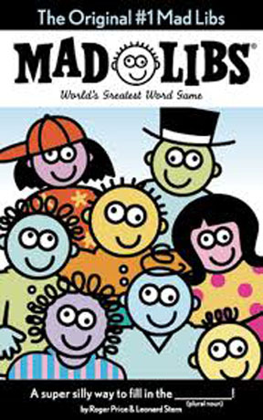
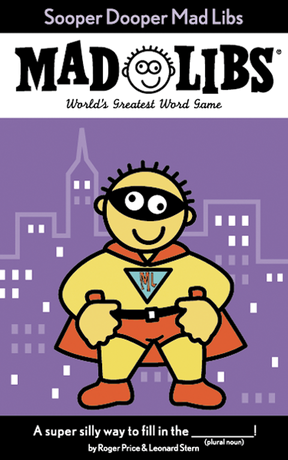
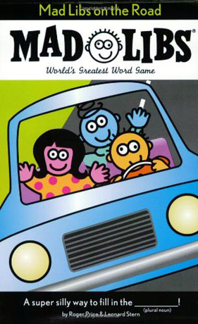
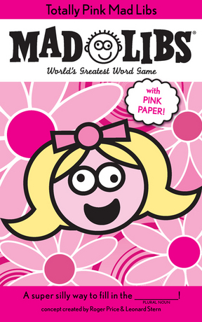
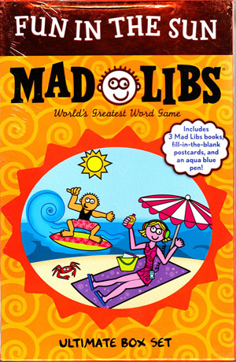
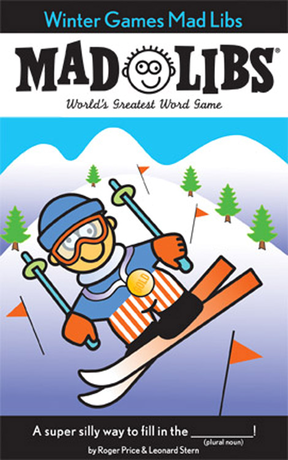

**Mad Libs** is a word game that starts from a quote or a short story in which certain keywords have been left out. Below each omitted word, a lexical or other category is given, such as "*noun*", "*verb*", "*place*" or "*body part*". One player takes turns asking the other players to suggest a word within the category shown below the next omitted word, without revealing the context in which the word will be used. At the end, the completed quote or story is read aloud. The result is often comic, surreal and somewhat nonsensical.

Suppose, for example, that we start from the following partial quote.

<pre><code>______ created ______ so that _____________ would learn ____________.
 <i>Name</i>           <i>thing</i>          <i>INHABITANTS</i>               <i>discipline</i>
</code></pre>

The missing words could then be filled in in the following way

`God` created `war` so that `AMERICANS` would learn `geography`.

or just as well in the following way

`Mercator` created `maps` so that `BELGIANS` would learn `navigation`.

The game was invented in 1953 by Leonard Stern and Roger Price, and since the series was first published in 1958, more than 110 million copies of the *Mad Libs* books have been sold in the United States alone.



## Assignment

Write a class `MadLibs` whose objects can be used to complete a given quote or story in which keywords have been left out, based on words chosen at random from certain categories. Each object of this class must have a property `vocabulary` that refers to another object. This object represents the vocabulary that the `MadLibs` object has been taught. Initially this vocabulary object is still empty, but during the lifetime of the `MadLibs` object new information can be added to it, or the information in the vocabulary object can be consulted when calling the following methods that must at least be supported by the class `MadLibs`:

- A method `learn` that can be used to add additional words in a given category to the vocabulary of the object. Two arguments must be passed to this method: *i*) the category of the new words and *ii*) one or more words within this category. If a single word is passed as the second argument, that word may be passed as a string. If multiple words are passed as the second argument, these words must be passed as an array. The method must make sure that the vocabulary object is extended by adding the given words to the array onto which the given category is mapped by the vocabulary object. If the vocabulary object did not yet contain a property that corresponds to the given category, a new property-value pair must be created, where the property is formed by the given category, and the value is formed by the array of the given words. All categories and words that are included in the vocabulary object must always be converted to lowercase.
- A method `suggest` that can be used to suggest a word from a given category. This category must be passed as an argument to the method. The method must choose a random word from the array onto which the given category is mapped by the vocabulary object. If the given category does not occur as a property in the vocabulary object, the method must throw a `MadLibsError` with the message `unknown category`. If all letters that occur in the given category are uppercase, the letters in the chosen word must also be converted to uppercase. If the first letter of the given category is uppercase and all following letters are lowercase, the first letter of the chosen word must also be converted to uppercase. Finally, the method must return (the modified version of) the chosen word.
- A method `fill` to which a string must be passed. This string may contain fragments that are enclosed between two underscores (`_`). These fragments indicate the name of a category, and represent omitted keywords of that category. The method must replace each of these fragments (including the leading and trailing underscore) by a randomly chosen word of that category. To do so, a word must be suggested using the method `suggest`, so that the rules for modifying the suggested word implemented by that method also apply. The string in which all omitted keywords have been replaced by randomly chosen words must be returned. If the given string contains a fragment that does not correspond to a category in the property vocabulary, the method must throw a `MadLibsError` with the message `unknown category`.

## Example

```javascript
>> var madlib = new MadLibs();
>> madlib.vocabulary;
{}

>> madlib.learn('name', 'God');
>> madlib.learn('thing', 'war');
>> madlib.learn('inhabitants', 'Americans');
>> madlib.learn('discipline', 'geography');
>> madlib.vocabulary;
{'name': ['god'], 'thing': ['war'], 'inhabitants': ['americans'], 'discipline': ['geography']}
>> madlib.suggest('name');
'god'
>> madlib.suggest('NAME');
'GOD'
>> madlib.suggest('Name');
'God'
>> madlib.fill('_Name_ created _thing_ so that _INHABITANTS_ would learn _discipline_.');
'God created war so that AMERICANS would learn geography.'

>> madlib.learn('name', ['Mercator', 'Caesar']);
>> madlib.learn('thing', ['maps', 'coordinates']);
>> madlib.learn('inhabitants', ['Belgians', 'Martians', 'Germans'])
>> madlib.learn('discipline', 'navigation');
>> madlib.learn('discipline', 'colonisation');
>> madlib.vocabulary;
{'name': ['god', 'mercator', 'caesar'], 'thing': ['war', 'maps', 'coordinates'], 'inhabitants': ['americans', 'belgians', 'martians', 'germans'], 'discipline': ['geography', 'navigation', 'colonisation']}
>> madlib.fill('_Name_ created _thing_ so that _INHABITANTS_ would learn _discipline_.');
'Mercator created maps so that BELGIANS would learn geography.'
>> madlib.fill('_Name_ created _thing_ so that _INHABITANTS_ would learn _discipline_.');
'Mercator created war so that BELGIANS would learn navigation.'
```
