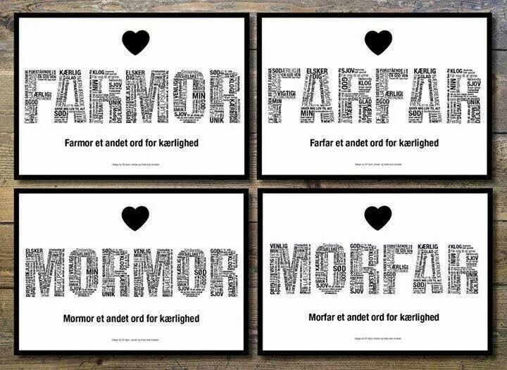
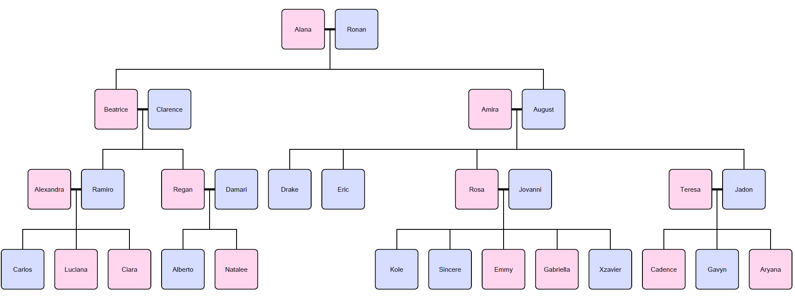

<p>One of the most fascinating things about learning foreign languages is
    the discovery that some words simply cannot be translated. Just because
    they have no direct counterpart in our language. Because how on earth do
    you translate the fourteen different words that Eskimos use for snow? Or
    the Swedish word <i>lagom</i>, which means something like "not too much,
    and not too little". The German word <i>&#252;berhaupt</i> also turned
    out to be s&#243; hard to translate that we eventually adopted it
    unchanged.</p>
<p>Likewise, Swedish has no words that are equivalent to grandmother or
    grandfather. When naming their ancestors, Swedes will <b>always</b>
    indicate whether they refer to descent on the mother's or the father's
    side. In Swedish, you translate mother as <i>mor</i> and father as <i>far</i>.
    Your grandmother on your mother's side then becomes <i>mormor</i>
    (literally: your mother's mother) and your grandmother on your father's
    side <i>farmor</i> (literally: your father's mother). Similarly, you
    translate grandfather on your mother's side as <i>morfar</i> and
    grandfather on your father's side as <i>farfar</i>. If you wanted to
    translate that into English anyway, you would end up with something like
    mama, mapa, pama and papa. And that really doesn't look like anything,
    does it?</p>
<div class="dodona-centered-group">
</div>
<p>In the same way, Swedes refer to their great-grandparents,
    great-great-grandparents and even more distant ancestors. For example,
    <i>morfarfar</i> is your mother's father's father, and
    <i>farmorfarmor</i> is your father's mother's father's mother.</p>
<p>The Swedish way of describing ancestors sometimes leads to complicated
    situations. After all, ancestors are addressed in different ways by their
    descendants, even if those belong to the same generation. If a
    grandmother has grandchildren from her sons &#233;nd her daughters, they
    will be shouting <i>farmor</i> and <i>mormor</i> all at once. Meanwhile,
    grandfather no longer knows whether he should respond to <i>morfar</i>
    or to <i>farfar</i> first.</p>
<h3>Assignment</h3>
<p>In this assignment we work with family trees that were drawn up
    according to a simplified model, in which the following conditions are
    always met:</p>
<ul>
    <li>
        <p>each person has a unique name, which contains no spaces</p>
    </li>
    <li>
        <p>each person has children with at most one partner (of the opposite
            sex)</p>
    </li>
    <li>
        <p>each child always has one mother and one father; parents are not
            necessarily included in the family tree, but if one of the
            parents of the child is included, then the other one automatically
            is as well</p>
    </li>
    <li>
        <p>each person has a unique path in the family tree to each of his
            ancestors</p>
    </li>
</ul>
<p>The image below shows an example of such a family tree, in which women
    are marked in pink and men in blue. Couples with children are connected
    by a thick horizontal line, and the other relations must be read from top
    to bottom, with the mother and the father at the top, and their children
    below them. The last condition that we imposed on family trees means that
    there is no incest within a family tree (so, for example, there are never
    children from a relationship between a father and his daughter, or from
    relationships between cousins).</p>
<div class="dodona-centered-group"></div>
<p>The relations from a family tree are stored in a text file, each line of
    which consists of three or more names that are separated from each other
    by spaces. The first name is that of the mother, the second that of the
    father, and the remaining names those of their children. This way, the
    example file below contains all relations from the family tree in the
    image above.</p>
<pre>Alana Ronan Beatrice August
Beatrice Clarence Ramiro Regan
Alexandra Ramiro Carlos Luciana Ciara
Regan Damari Alberto Natalee
Amira August Drake Eric Rosa Jadon
Rosa Jovanni Kole Sincere Emmy Gabriella Xzavier
Teresa Jadon Cadence Gavyn Aryana</pre>
<p>Note that there is no fixed order in which the lines of the file are
    listed. Your task:</p>
<ul>
    <li>
        <p>Write a function <samp>familyMembers</samp> that takes the location
            of a text file. This text file must contain information about a
            family tree, in the format described above. The function must
            return an object that maps the names of all members of the family
            tree onto an object that can contain the following keys:</p>
    </li>
    <ul>
        <li>
            <p><samp>mother</samp>: is mapped onto the name of the mother of
                the family member</p>
        </li>
        <li>
            <p><samp>father</samp>: is mapped onto the name of the father of
                the family member</p>
        </li>
        <li>
            <p><samp>children</samp>: is mapped onto a list with the names of
                all children of the family member</p>
        </li>
    </ul>
    <p>Only keys that correspond to relations about which information can be
        derived from the given text file may be included in the object.</p>
</ul>
<ul>
    <li>
        <p>Write a function <samp>ancestor</samp> that takes three arguments:
            <i>i</i>) the name of a family member, <i>ii</i>) the Swedish
            description of an ancestor and <i>iii</i>) an object that describes
            the relations in a family tree (formatted like the objects
            returned by the function <samp>familyMembers</samp>). The function
            must return the name of the ancestor that the given family member
            addresses in Swedish with the given description, taking into
            account the relations in the given family tree. The function may
            assume that the given name of the family member occurs as a key in
            the given object, and that the Swedish description of the ancestor
            is a string composed of the substrings <samp>mor</samp> and
            <samp>far</samp>, without this having to be checked explicitly. If
            the given family tree contains no ancestor of the given family
            member that is addressed with the given description, the function
            must throw an <samp>AssertionError</samp> with the message
            <samp>unknown ancestor</samp>.</p>
    </li>
    <li>
        <p>Write a function <samp>descendants</samp> that takes three
            arguments: <i>i</i>) the name of a family member, <i>ii</i>) a
            number $$n \in \mathbb{N}_0$$ and <i>iii</i>) an object that
            describes the relations in a family tree (formatted like the
            objects returned by the function <samp>familyMembers</samp>). The
            function must return an object whose keys are all Swedish
            descriptions with which the given family member is addressed by
            his/her $$n$$-th generation descendants from the given family
            tree. Each of these descriptions must be mapped by the object onto
            a list with all descendants from the given family tree that
            address the given family member with that description. This list
            must be sorted alphabetically. The function may assume that the
            given name of the family member occurs as a key in the given
            object, without this having to be checked explicitly. The
            generations of descendants are determined relative to the given
            family member: the first generation consists of the children of
            the family member, the second generation of the grandchildren, the
            third generation of the great-grandchildren, and so on.</p>
    </li>
</ul>
<h3>Example</h3>
<p>In the example session below we assume that the file <a target="_blank"
                                                           href="media/data/data.txt"><samp>data.txt</samp></a>
    is located in the current directory. This is the text file that
    corresponds to the family tree that was used as an example in the
    description of the assignment.</p>

```javascript
>> const relations = familyMembers('data.txt');
>> relations['Sincere'];
{'father': 'Jovanni', 'mother': 'Rosa'}
>> relations['August'];
{'father': 'Ronan', 'mother': 'Alana', 'children': ['Eric', 'Drake', 'Jadon', 'Rosa']}
>> relations['Ronan'];
{'children': ['Beatrice', 'August']}

>> ancestor('Drake', 'mor', relations);
'Amira'
>> ancestor('Rosa', 'farmor', relations);
'Alana'
>> ancestor('Sincere', 'morfarfar', relations);
'Ronan'
>> ancestor('Luciana', 'morfarmor', relations);
AssertionError: unknown ancestor

>> descendants('Ronan', 1, relations);
{'far': [ 'August', 'Beatrice']}
>> descendants('Ronan', 2, relations);
{'morfar': ['Ramiro', 'Regan'], 'farfar': ['Drake', 'Eric', 'Jadon', 'Rosa']}
>> descendants('Ronan', 3, relations);
{'farmorfar': ['Carlos', 'Ciara', 'Luciana'], 'farfarfar': ['Aryana', 'Cadence', 'Gavyn'], 'mormorfar': ['Alberto', 'Natalee'], 'morfarfar': ['Emmy', 'Gabriella', 'Kole', 'Sincere', 'Xavier']}
```

<h3>Epilogue</h3>
<p>The word <i>mamihlapinatapais</i> from the language of the <a target="_blank"
                                                                href="https://en.wikipedia.org/wiki/Yaghan_people">Yaghan people</a>
    who live in icy Tierra del Fuego is considered the most succinct word in
    the world &#8212; and also the word that is hardest to translate. It
    means something like "a look shared by two people, each wishing that the
    other would initiate something that they both fervently desire, but which
    neither of them feels like taking the initiative for".</p>
<p>A 2004 survey among 1000 linguists yielded yet another word that should
    be the hardest word in the world to translate: <i>ilunga</i>. The word
    comes from <a target="_blank" href="https://en.wikipedia.org/wiki/Luba-Kasai_language">Tshiluba</a>,
    a Bantu language spoken in the Democratic Republic of the Congo, where it
    is also an official language used in education. It means "a person who is
    ready to forgive any abuse for the first time, to tolerate it a second
    time, but never a third time".</p>
<p>Here are some more favourite words of linguist Mikael Parkvall of
    Stockholm University, from his <a target="_blank"
                                      href="https://www.amazon.com/Limits-Language-Almost-Everything-Languages/dp/1590281985/ref=sr_1_1?ie=UTF8&amp;qid=1490684258"><i>Limits
        of language: almost everything you didn't know about language and
        languages</i></a> (2006):</p>
<ul>
    <li>
        <p><i>klunen</i> (Frisian): to walk or run over land with skates on
            (usually to get from one frozen body of water to another)</p>
    </li>
    <li>
        <p><i>a&#611;one</i> (Kuot): to drink from a bottle in such a way that
            the trickles of drool from the mouth run back into the bottle</p>
    </li>
    <li>
        <p><i>fringsen</i> (German): stealing coal from railway wagons or
            potatoes from the fields in order to survive</p>
    </li>
    <li>
        <p><i>knedlikov&#253;</i> (Czech): about dumplings that are rather
            incomplete</p>
    </li>
    <li>
        <p><i>qamigartuk</i> (Yup'ik): one who goes seal hunting in spring
            with a small sled and a kayak</p>
    </li>
    <li>
        <p><i>bale&#331;ga</i> (Chavacano): excessive swinging of the arms
            while walking</p>
    </li>
    <li>
        <p><i>kallsup</i> (Swedish): a mouthful of water accidentally
            swallowed by a swimmer</p>
    </li>
    <li>
        <p><i>googly</i> (English): (of a ball bowled in cricket) disguised by
            the bowler with an action that apparently makes it break the
            other way</p>
    </li>
</ul>
<p>Gunwinggu &#8212; a language spoken in the northwest of
    Australia &#8212; has separate verbs to describe the hopping around of
    different kinds of kangaroos:</p>
<ul>
    <li>
        <p><i>kamurlbardme</i>: the hopping around of a black wallaroo (<a target="_blank"
                                                                           href="https://en.wikipedia.org/wiki/Black_wallaroo"><i>Macropus
            bernardus</i></a>)</p>
    </li>
    <li>
        <p><i>kalurlhlurme</i>: the hopping around of an agile wallaby (<a target="_blank"
                                                                           href="https://en.wikipedia.org/wiki/Agile_wallaby"><i>Macropus
            agilis</i></a>)</p>
    </li>
    <li>
        <p><i>kamawudme</i>: the hopping around of a male antilopine
            kangaroo (<a target="_blank" href="https://en.wikipedia.org/wiki/Antilopine_kangaroo"><i>Macropus
                antilopinus</i></a>)</p>
    </li>
    <li>
        <p><i>kadjalwahme</i>: the hopping around of a female antilopine
            kangaroo (<a target="_blank" href="https://en.wikipedia.org/wiki/Antilopine_kangaroo"><i>Macropus
                antilopinus</i></a>)</p>
    </li>
</ul>
