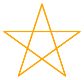

In this exercise, you'll use the `turtle` module to draw a **star**.

Your program should:

1. Read an **odd integer** `n` (at least 5) from input: the number of points of the star.
2. Draw the star with the pen color set to `orange` and the pen size set to 3. Start where the turtle starts (the centre of the canvas, facing right) and repeat `n` times: move forward 150 pixels, then turn right by `180 - 180 / n` degrees.

Your program is run several times, once for each input, and every drawing is compared to the expected one. So it has to work for any odd `n`, not just for one star.

Here is the star for `n = 5`:

{:height="50%" width="50%"}{: style="border-style: inset"}

#### Fun fact

Why does `n` have to be odd? After `n` turns, the turtle has turned `180 * (n - 1)` degrees in total. That is a whole number of full turns only when `n` is odd, and only then does the star close up again.
