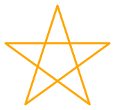

In deze oefening gebruik je de `turtle`-module om een **ster** te tekenen.

Je programma moet:

1. Een **oneven geheel getal** `n` (minstens 5) inlezen: het aantal punten van de ster.
2. De ster tekenen met de penkleur `orange` en een pendikte van 3. Begin waar de turtle begint (het midden van het canvas, kijkend naar rechts) en herhaal `n` keer: 150 pixels vooruit, dan `180 - 180 / n` graden naar rechts draaien.

Je programma wordt meerdere keren uitgevoerd, telkens met een andere invoer, en elke tekening wordt vergeleken met de verwachte tekening. Het moet dus werken voor elk oneven getal `n`, niet enkel voor één ster.

Dit is de ster voor `n = 5`:

{:height="50%" width="50%"}{: style="border-style: inset"}

#### Weetje

Waarom moet `n` oneven zijn? Na `n` bochten is de turtle in totaal `180 * (n - 1)` graden gedraaid. Dat is enkel een geheel aantal volledige rondjes als `n` oneven is, en alleen dan sluit de ster netjes.
